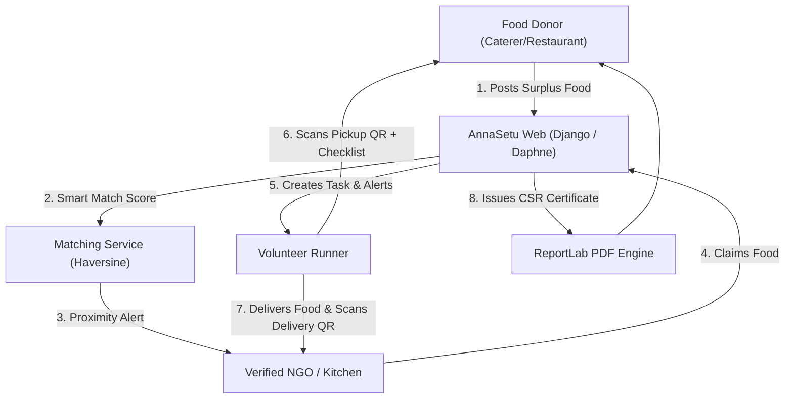
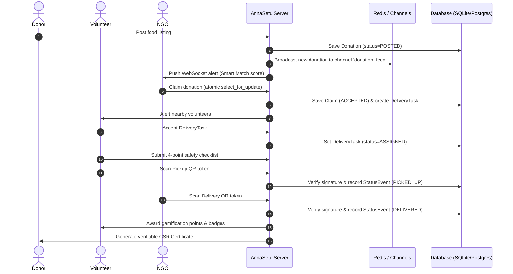

# AnnaSetu — System Architecture (ARCHITECTURE.md)

AnnaSetu connects surplus food donors with verified NGOs and volunteer runners across India with an audit-logged cryptographic chain of custody.

---

## 1. System Context Diagram

---

## 2. Real-Time & Event Architecture

---

## 3. Technology Stack Breakdown

| Layer | Technologies |
|---|---|
| **Web Server / ASGI** | Django 5.x, Daphne, Gunicorn, WhiteNoise |
| **Real-time WebSockets** | Django Channels, `channels-redis` (with InMemory dev fallback) |
| **API & Documentation** | Django REST Framework, SimpleJWT, `drf-spectacular` (OpenAPI 3 / Swagger) |
| **Database** | SQLite (Dev) / PostgreSQL (Prod via `dj-database-url`) |
| **Geo Engine** | Pure-Python Haversine with DB Bounding Box Indexing |
| **Async Jobs** | Celery + Celery Beat + Redis |
| **Frontend** | Tailwind CSS, Alpine.js, HTMX, Leaflet.js (OpenStreetMap), Chart.js, Lucide Icons |
| **Document Generation** | ReportLab (CSR PDF certificates), QRCode (PIL) |
